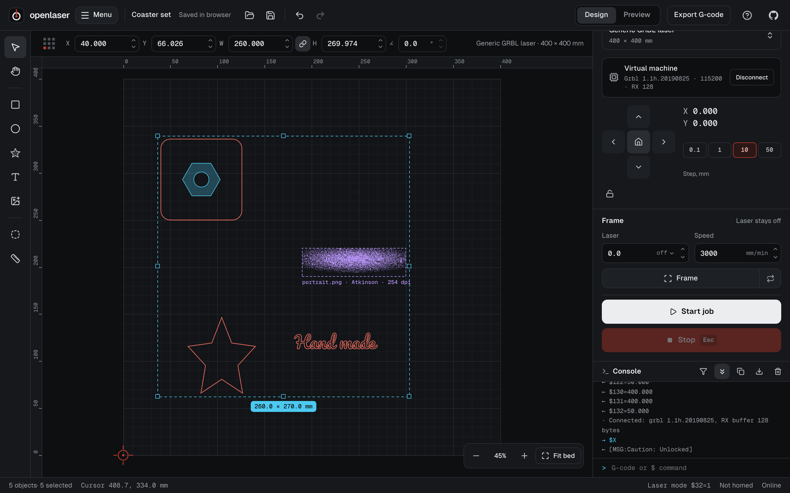
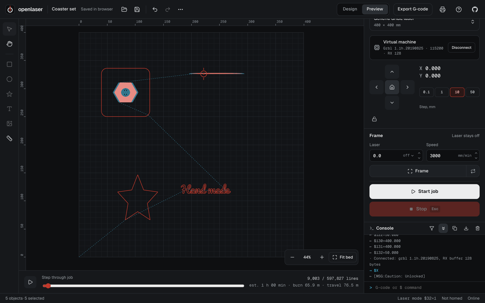
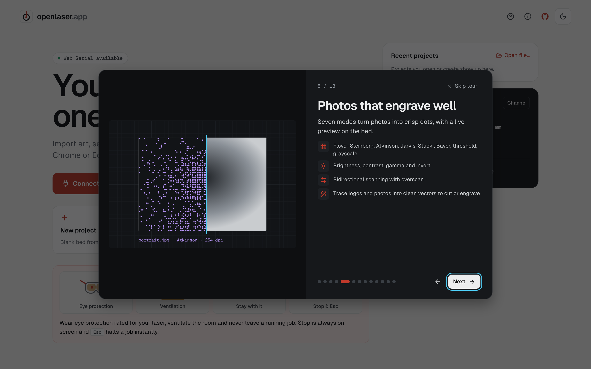

<p align="center">
  
</p>

<h1 align="center">openlaser</h1>

<p align="center">
  <strong>Your laser, one tab away.</strong><br />
  Free, open source laser engraver and cutter control that runs entirely in your browser.
</p>

<p align="center">
  <a href="https://openlaser.app">Open the app</a> ·
  <a href="https://github.com/theanam/openlaser.app/issues">Report an issue</a> ·
  <a href="#development">Develop</a>
</p>

<p align="center">
  
</p>

## What it does

openlaser designs, previews and runs jobs on GRBL laser engravers and cutters. Open the page in Chrome or Edge, plug in your laser over USB, and go. Nothing to install, no account, and it keeps working offline.

- **Connect over Web Serial** to GRBL 1.1, grblHAL and FluidNC machines, or practise on the built-in virtual machine.
- **Import art**: SVG and DXF at their real size, PNG, JPEG, WebP, AVIF, BMP and GIF. Drag files anywhere onto the app.
- **Layers** in line, fill and image modes, with speed, power, passes, kerf offset, fill angle, cross-hatch and overscan.
- **Image tracing** that turns logos, line art and photos into clean vector layers to cut or engrave, with a live preview.
- **Photo engraving** with Floyd–Steinberg, Atkinson, Jarvis, Stucki, Bayer, threshold and grayscale, previewed live on the bed.
- **Text in any Google Font**, an installed system font or your own TTF, OTF or WOFF files, picked from a searchable list with live previews and burned as clean vector outlines.
- **Outline tool** that draws one cut line around a selection at any offset: a logo and its key-ring hole get a single outline.
- **Shape library** with stars, gears, arrows, hearts, callouts and more, each with adjustable parameters, plus rectangle, ellipse and measure tools.
- **Exact placement** with X, Y, W, H and angle fields and a 9-point anchor.
- **Preview** every burn and travel move, scrub through the job, and see a time estimate.
- **Run jobs** with framing (once or looping, laser off or at low power), a visual pre-flight check, pause, resume, live speed and power overrides, and a Stop button that is always on screen (Esc works too).
- **Machine control**: jog pad, homing, set origin, alarm help, an always-visible console of every line sent and received, and a `$$` settings editor with backup and restore.
- **70+ machine presets** from Ortur, Sculpfun, Atomstack, Two Trees, Creality and more, with automatic detection when you connect.
- **CO₂ lasers**: tubes on GRBL boards connect over USB at constant power; Ruida machines (Thunder, Aeon, OMTech and others) get `.rd` job files to run from a USB stick.
- **Send G-code files** straight to the machine.
- **Projects** autosave in the browser and save to disk as `.olaser` files with their images inside. Machine profiles save as `.json`.
- **Print a 1:1 template** of the design as true vector output.

<p align="center">
  
  
</p>

## Browser support

Machine control needs [Web Serial](https://developer.mozilla.org/docs/Web/API/Web_Serial_API), available in Chrome, Edge, Opera and Brave on desktop. Design, preview and G-code export work in other browsers too.

If your laser does not show up in the port list, install the CH340 or CP210x USB driver. On Linux, add yourself to the `dialout` group and log in again.

## Safety

The laser fires only when you start a job. Framing runs with the laser off unless you enable a low frame power (5% at most). The first job of each session asks you to confirm a short safety checklist. Always wear eye protection rated for your laser, ventilate the room and stay with the machine while it runs.

## Development

openlaser is a static Svelte 5 + TypeScript app built with Vite. There is no backend.

```sh
corepack enable          # provides the pinned pnpm version
pnpm install
pnpm dev                 # http://localhost:5190
```

| Command | What it does |
| --- | --- |
| `pnpm test` | Unit, property and golden tests (Vitest) |
| `pnpm e2e` | End-to-end tests against the virtual machine (Playwright, Chromium) |
| `pnpm typecheck` | `svelte-check` in strict mode |
| `pnpm lint` | ESLint |
| `pnpm build` | Production build in `dist/`, ready for any static host |
| `pnpm golden:update` | Regenerate G-code golden files (review the diff) |
| `pnpm screenshot` | Refresh the README screenshots from a production build |
| `pnpm icons` | Render PWA icons and the social preview image |
| `pnpm fonts:update` | Refresh the Google Fonts catalogue from Fontsource |

The code is split into layers with one-way dependencies:

- `src/lib/project`: document model, undo history, `.olaser` files
- `src/lib/import`: SVG, DXF, image and G-code importers
- `src/lib/fonts`, `src/lib/shapes`, `src/lib/trace`: Google Fonts and text outlines, parametric shapes, image tracing
- `src/lib/cam`: pure toolpath generation and the G-code emitter
- `src/lib/machine`: Web Serial transport, GRBL driver, job streaming and the GRBL simulator
- `src/app`: the Svelte interface

Design decisions are logged in [docs/decisions.md](docs/decisions.md).

### Deploying

Pushing to `main` builds and publishes the app to GitHub Pages through `.github/workflows/pages.yml`. The build uses relative paths, so it also works from any other static host.

## Contributing

Bug reports and pull requests are welcome. For hardware problems, open the console, press **Download log** and attach the file to your [issue](https://github.com/theanam/openlaser.app/issues). For anything else, write to [anam.ahmed.a@gmail.com](mailto:anam.ahmed.a@gmail.com).

## License

[MIT](LICENSE)
