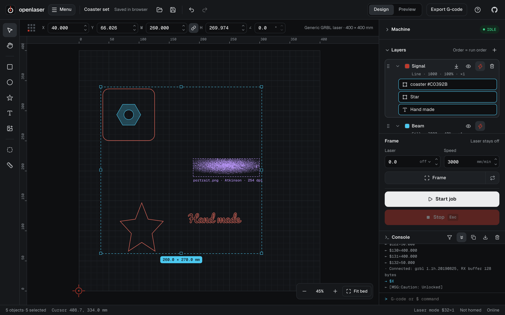
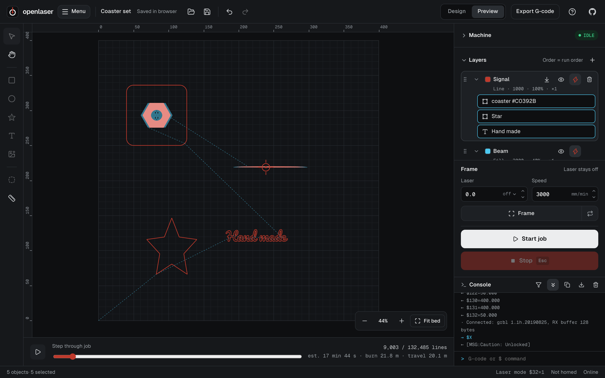
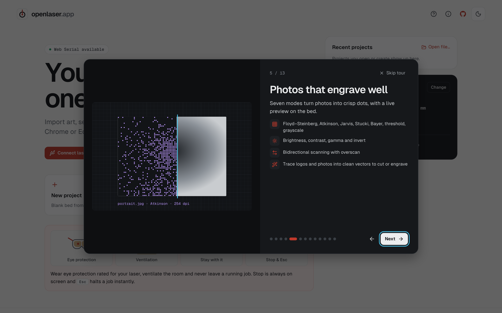

<p align="center">
  
</p>

<h1 align="center">openlaser</h1>

<p align="center">
  <strong>Your laser, one tab away.</strong><br />
  Free, open source laser engraver and cutter control that runs entirely in your browser.
</p>

<p align="center">
  <a href="https://openlaser.app">Open the app</a> ·
  <a href="https://github.com/theanam/openlaser.app/issues">Report an issue</a> ·
  <a href="#development">Develop</a>
</p>

<p align="center">
  
</p>

## What it does

openlaser designs, previews and runs jobs on GRBL laser engravers and cutters. Open the page in Chrome or Edge, plug in your laser over USB, and go. Nothing to install, no account, and it keeps working offline.

- **Connect over Web Serial** to GRBL 1.1, grblHAL and FluidNC machines, or practise on the built-in virtual machine.
- **Import art**: SVG and DXF at their real size, PNG, JPEG, WebP, AVIF, BMP and GIF. Drag files anywhere onto the app.
- **Layers** in line, fill and image modes, with speed, power, passes, kerf offset, fill angle, cross-hatch and overscan.
- **Material presets** for engraving and cutting: LaserPecker's own tables per model, and published diode and CO₂ settings by laser power.
- **Image tracing** that turns logos, line art and photos into clean vector layers to cut or engrave, with a live preview.
- **Photo engraving** with Floyd–Steinberg, Atkinson, Jarvis, Stucki, Bayer, threshold and grayscale, previewed live on the bed.
- **Text in any Google Font**, an installed system font or your own TTF, OTF or WOFF files, picked from a searchable list with live previews and burned as clean vector outlines. Bangla, Devanagari, Arabic and other scripts are shaped with HarfBuzz.
- **Outline tool** that draws one cut line around a selection at any offset: a logo and its key-ring hole get a single outline.
- **Shape library** with stars, gears, arrows, hearts, callouts and more, each with adjustable parameters, plus rectangle, ellipse and measure tools.
- **Exact placement** with X, Y, W, H and angle fields, a 9-point anchor, and smart guides that snap dragged art to other objects and the bed.
- **Preview** every burn and travel move, scrub through the job, and see a time estimate.
- **Run jobs** with framing (once or looping, laser off or at low power), a visual pre-flight check, pause, resume, live speed and power overrides, and a Stop button that is always on screen (Esc works too).
- **Machine control**: jog pad, homing, set origin, alarm help, an always-visible console of every line sent and received, and a `$$` settings editor with backup and restore.
- **70+ machine presets** from Ortur, Sculpfun, Atomstack, Two Trees, Creality and more, with automatic detection when you connect.
- **CO₂ lasers**: tubes on GRBL boards connect over USB at constant power; Ruida machines (Thunder, Aeon, OMTech and others) get `.rd` job files to run from a USB stick.
- **LaserPecker engravers** over Bluetooth straight from the browser, or USB. See [LaserPecker](#laserpecker).
- **Rotary, slide and two-laser setups** live in the machine profile: pick the rotary in the Machine panel and the work area, axis scaling and mode switch follow; each layer can pick its laser.
- **Send G-code files** straight to the machine.
- **Projects** autosave in the browser and save to disk as `.olaser` files with their images inside. Machine profiles save as `.json`.
- **Print a 1:1 template** of the design as true vector output.

<p align="center">
  
  
</p>

## Browser support

Machine control needs [Web Serial](https://developer.mozilla.org/docs/Web/API/Web_Serial_API), available in Chrome, Edge, Opera and Brave on desktop. Design, preview and G-code export work in other browsers too.

LaserPeckers also connect over [Web Bluetooth](https://developer.mozilla.org/docs/Web/API/Web_Bluetooth_API) in Chrome and Edge. On Linux and in Brave, Bluetooth sits behind a browser setting; press **Connect laser → Bluetooth** and openlaser shows where to switch it on.

If your laser does not show up in the port list, install the CH340 or CP210x USB driver. On Linux, add yourself to the `dialout` group and log in again.

## LaserPecker

openlaser drives LaserPecker engravers directly. Pick **Connect laser → Bluetooth** or **USB**; the model is detected and its profile set up.

- **Bluetooth from the browser**, with no LaserPecker dongle: the computer's own Bluetooth is enough. LP2, LP3 and LP4 are supported.
- **USB** at 460800 baud: LP2 and LP3 on LaserPecker's own protocol, LP4 and LP5 on G-code with LaserPecker's M-codes, like LightBurn.
- **Frame, engrave, pause and stop** from the app. Framing traces the job's outline at the lowest power.
- **Burn depth and power** as LaserPecker shows them, with LaserPecker's material settings for each model, resolution (1K to 4K) and laser.
- **Both lasers on the LP4 and LP5**: each layer picks 450 nm blue or 1064 nm infrared.
- **Rotary and slide** from the Machine panel, with the work area following.

Over Bluetooth (and on the LP2 and LP3 over USB), the laser takes each layer as an image, so line layers engrave their lines and cannot cut. To cut on an LP4 or LP5, connect over USB.

Protocol details come from the [LaserPecker protocol notes](https://github.com/nerdocs/pyrograph/blob/main/docs/protocol.md) by nerdocs (see [Credits](#credits)). LaserPecker is a trademark of its owner; openlaser is not affiliated with it.

## Safety

The laser fires only when you start a job. Framing runs with the laser off unless you enable a low frame power (5% at most). The first job of each session asks you to confirm a short safety checklist. Always wear eye protection rated for your laser, ventilate the room and stay with the machine while it runs.

## Library

Everything under the interface is a library you can build on: [libopenlaser](packages/libopenlaser) on npm. It connects to GRBL lasers over USB and LaserPecker engravers over Bluetooth, exports Ruida `.rd` files, compiles designs to G-code, and imports SVG, DXF, images and fonts.

```bash
npm i libopenlaser
```

```ts
import { compileJob } from 'libopenlaser/cam';
import { GrblConnection, WebSerialTransport } from 'libopenlaser/machine';

const plan = compileJob({ project, profile, assets: new Map() });
const machine = await GrblConnection.open(await WebSerialTransport.request(), profile);
await machine.run({ lines: plan.gcode });
```

The [library README](packages/libopenlaser/README.md) has guides for each machine, design tools, presets and safety, with examples the tests run.

## Development

openlaser is a static Svelte 5 + TypeScript app built with Vite. There is no backend.

```sh
corepack enable          # provides the pinned pnpm version
pnpm install
pnpm dev                 # http://localhost:5190
```

| Command              | What it does                                                        |
| -------------------- | ------------------------------------------------------------------- |
| `pnpm test`          | Unit, property and golden tests (Vitest)                            |
| `pnpm e2e`           | End-to-end tests against the virtual machine (Playwright, Chromium) |
| `pnpm typecheck`     | `svelte-check` in strict mode                                       |
| `pnpm lint`          | ESLint                                                              |
| `pnpm build`         | Production build in `dist/`, ready for any static host              |
| `pnpm lib:build`     | Build `libopenlaser` into `packages/libopenlaser/dist`              |
| `pnpm golden:update` | Regenerate G-code golden files (review the diff)                    |
| `pnpm screenshot`    | Refresh the README screenshots from a production build              |
| `pnpm icons`         | Render PWA icons and the social preview image                       |
| `pnpm fonts:update`  | Refresh the Google Fonts catalogue from Fontsource                  |

The code is split into layers with one-way dependencies:

- `packages/libopenlaser`: the library the app is built on, published to npm as `libopenlaser`
  - `geometry`: vectors, matrices, paths and polygon offsets
  - `project`: document model, undo history, machine profiles and presets, materials, `.olaser` files
  - `cam`: pure toolpath generation, the G-code emitter and per-controller job encoders
  - `machine`: transports, the machine connection contract, the GRBL and LaserPecker drivers, job streaming and the simulators
  - `import`: SVG, DXF, image and G-code importers
  - `fonts`, `shapes`, `trace`: Google Fonts and text outlines, parametric shapes, image tracing
- `src/lib`: app plumbing: storage, UI primitives, workers and app identity
- `src/app`: the Svelte interface; `src/app/machines` holds one adapter per controller

To support another kind of machine, see [docs/adding-a-machine.md](docs/adding-a-machine.md).

Design decisions are logged in [docs/decisions.md](docs/decisions.md).

### Deploying

Pushing to `main` builds and publishes the app to GitHub Pages through `.github/workflows/pages.yml`. The build uses relative paths, so it also works from any other static host.

## Contributing

Bug reports and pull requests are welcome. For hardware problems, open the console, press **Download log** and attach the file to your [issue](https://github.com/theanam/openlaser.app/issues). For anything else, write to [anam.ahmed.a@gmail.com](mailto:anam.ahmed.a@gmail.com).

## Credits

LaserPecker protocol details come from the [LaserPecker protocol notes](https://github.com/nerdocs/pyrograph/blob/main/docs/protocol.md) by nerdocs. openlaser implements the protocol independently from that description; no code from pyrograph is included.

## License

[MIT](LICENSE)
